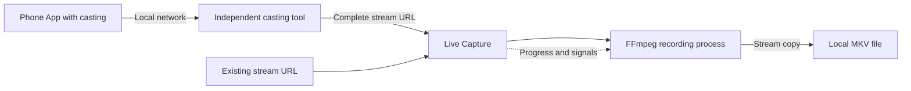

<div align="center">

# Live Capture

**Keep the live stream. See every recording.**

A macOS recording manager for FFmpeg: paste a stream URL, create a task, monitor progress, and save the original audio and video.

[](#requirements)
[](#choose)
[](#how-it-works)
[](#python-gui)
[](https://github.com/Nothings2Seeyeyeye/live-capture-recorder/stargazers)

[简体中文](README.md) · **English**

[Quick start](#quick-start) · [Controls](#controls) · [Capture a URL](#capture-url) · [Troubleshooting](#troubleshooting) · [Contributing](CONTRIBUTING.md)

</div>

> **Inspiration:** Live Capture was inspired by [gtoxlili/wechat-finder-dlna](https://github.com/gtoxlili/wechat-finder-dlna) and its approach to capturing live-stream URLs. Thank you to its author and contributors for sharing the implementation. [Read the acknowledgements](#credits).

> **First time here?** If you already have a complete HLS / `m3u8` URL, follow Quick start. If you only have a WeChat live-stream page, first follow Capture a URL.

## Why Live Capture

- **Stream copy:** save source audio and video without re-encoding.
- **Multiple recordings:** the native App gives each task its own card with a PID, path, file size, media duration, speed and logs.
- **Process controls:** pause, resume, request a clean stop, or force termination when necessary.
- **Keep awake:** optionally use macOS `caffeinate` while recording.
- **Attach existing recordings:** the native App can manage an FFmpeg process you started elsewhere.
- **Readable Python source:** a standard-library-only Tkinter implementation is available for single-task recording and modification.

Live Capture manages recording. A separate casting tool can obtain stream URLs; casting discovery is not built into this App.

<a id="choose"></a>
## Choose an interface

| Capability | Native macOS App | Python / Tkinter GUI |
| --- | --- | --- |
| Entry point | `GUI/Live Capture.app` | `GUI/app.py` |
| Concurrent recordings | Multiple | One |
| Progress, size and logs | Yes | Yes |
| Pause / Resume / Stop / Kill | Yes | Yes |
| Keep awake | Yes | Yes |
| Attach by PID | Yes | No |
| Saved tasks and attempted reattachment to surviving processes | Yes | No |
| Delivery in this repository | Prebuilt arm64 App | Python source |
| Requirements | Apple Silicon, macOS 13+, FFmpeg | macOS, Python 3.11+, Tk, FFmpeg |

Apple Silicon users can start with the native App. Intel Mac users and developers can use the Python GUI. The Python implementation uses POSIX process signals and macOS `caffeinate`; Windows is not currently supported.

**Native build status:** this repository does not include Swift source, an Xcode project or a build script. The bundled App cannot be rebuilt from this checkout and is not notarized by Apple. See the [native App notes](GUI/README-native.md) for its architecture and build metadata.

<a id="requirements"></a>
## Requirements

- Native App: Apple Silicon Mac running macOS 13 or newer.
- All recording paths: FFmpeg and a writable directory with enough disk space.
- File inspection: FFprobe, usually installed alongside FFmpeg.
- Python GUI: Python 3.11+ with working Tk support.
- Optional casting tool: Python 3.10+ and a shared local network for your phone and Mac.

The native App does not require Python. [Homebrew](https://brew.sh/) is a convenient FFmpeg installation option; its [supported operating systems](https://docs.brew.sh/Installation) are separate from this App's minimum macOS version.

<a id="quick-start"></a>
## Quick start

Run these commands in macOS Terminal, completing each step before continuing.

### 1. Install FFmpeg

With Homebrew already installed:

```bash
brew install ffmpeg
ffmpeg -version
ffprobe -version
```

Without Homebrew, follow the [official installation instructions](https://brew.sh/) and complete the installer's PATH setup first. Both version commands should succeed.

### 2. Download and open the App

```bash
git clone https://github.com/Nothings2Seeyeyeye/live-capture-recorder.git
cd live-capture-recorder
open "GUI/Live Capture.app"
```

Alternatively, use **Code → Download ZIP** on GitHub, extract it, and open `GUI/Live Capture.app` in Finder. If macOS blocks launch, see Troubleshooting below.

### 3. Make a 30-second test recording

The bundled interface uses Chinese field labels:

| Field | What to enter |
| --- | --- |
| 直播流 URL | Complete stream URL, including all query parameters; a viewing-page URL is not enough |
| 保存目录 | Click 选择… to select your own writable personal directory; the native default is under the system shared directory |
| 文件名前缀 | `demo`, without an extension or path separators |
| 最长录制时长 | `00:00:30` for the first test |
| 录制时保持 Mac 唤醒 | Leave checked to use keep-awake behavior |

Click **Add Recording**. After initialization, check that file size and media duration increase. Output names follow `<prefix>_<YYYYMMDD_HHMMSS>.mkv`, using your Mac's local clock.

Once the task exits, open the MKV in a compatible player such as [VLC](https://www.videolan.org/vlc/). Confirm both audio and video. Then use a longer duration such as `01:00:00`, or leave duration blank to omit the limit. A blank duration runs until a manual stop, end of input, or error.

The duration limit applies to output media time, not a scheduled wall-clock stop time.

<a id="capture-url"></a>
## Capture a URL from casting

Use the independent [wechat-finder-dlna](https://github.com/gtoxlili/wechat-finder-dlna) tool when your phone's live-stream App provides a compatible casting URL:

```bash
brew install uv
uv tool install wechat-finder-dlna
uv tool run wechat-finder-dlna --name "Live Capture"
```

The last command keeps running while it waits for a cast. `uv tool run` works even when the installed tool's executable directory is not on PATH. See [uv's tool guide](https://docs.astral.sh/uv/guides/tools/) for installation details.

1. Connect your phone and Mac to the same local network.
2. Open a supported live stream and select its casting option.
3. Select **Live Capture** in the receiving-device list.
4. Copy the complete URL printed in Terminal, including its signature parameters.
5. Paste that URL into the recording App and start a test task.

If necessary, try only DLNA:

```bash
uv tool run wechat-finder-dlna --protocol dlna --name "Live Capture"
```

Device discovery and protocol support depend on the sender and network. Renew expired URLs by casting again. This project does not promise replay / VOD extraction, DRM handling, or authenticated stream access.

<a id="controls"></a>
## Controls and monitoring

| Control | Behavior |
| --- | --- |
| Add Recording / Start | Start an FFmpeg task; Python allows only one active task |
| Refresh | Manually refresh native task information |
| Pause | Send `SIGSTOP` to suspend the process |
| Resume | Send `SIGCONT` to resume it |
| Stop | Send `SIGTERM` to request termination and file finalization |
| Kill | Send `SIGKILL`; the output may be incomplete |
| Attach by PID | Attach the native App to your existing FFmpeg recording |
| 清理已结束任务 | Clear completed task cards |

**Resume a paused task before pressing Stop.** Pausing does not pause the live source or guarantee retention of the intervening content. A long pause may outlast the HLS segment window or connection.

Check file growth and duration alongside status. `speed=1x` is roughly real-time processing; higher initial values can reflect buffered source content. Media duration can differ from elapsed wall-clock time.

`Finished` generally indicates a normal FFmpeg exit. Inspect logs for `Failed` or `Exited`. The Python GUI may show `Exited` after a requested stop; inspect the output before concluding it is damaged.

<a id="advanced"></a>
## Advanced workflows

### Record several streams

Add each URL in the native App with a distinct prefix, such as `main-stage` or `workshop-a`. Each task has independent controls, while network and disk resources are shared.

### Attach an existing recording

Replace the placeholder URL and start this in another terminal:

```bash
STREAM_URL='https://example.com/live/index.m3u8?replace=with-real-url'
mkdir -p "$HOME/Movies/LiveCapture"
OUTPUT="$HOME/Movies/LiveCapture/manual_$(date +%Y%m%d_%H%M%S).mkv"
ffmpeg -nostdin -hide_banner -i "$STREAM_URL" -c copy "$OUTPUT" \
  > "${OUTPUT%.mkv}.log" 2>&1 &
RECORDING_PID=$!
echo "$RECORDING_PID"
```

Paste the printed FFmpeg PID into **Attach by PID**. Read `$!` immediately after starting the background command. Existing-task logs and progress may be less complete than those for tasks started in the App.

### Remux MKV to MP4

After recording has stopped, replace the filenames with actual paths:

```bash
ffmpeg -n -i "recording.mkv" -c copy -movflags +faststart "recording.mp4"
```

This requires source codecs compatible with MP4. `-n` prevents overwriting an existing output. If codec compatibility requires conversion:

```bash
ffmpeg -n -i "recording.mkv" -c:v libx264 -preset medium \
  -crf 20 -c:a aac -b:a 192k -movflags +faststart "recording-compatible.mp4"
```

Transcoding takes more resources, requires an FFmpeg build with `libx264`, and cannot recreate missing content.

### Inspect output and plan storage

```bash
ffprobe -v error -show_entries format=duration,size \
  -show_entries stream=codec_type,codec_name \
  -of json "recording.mkv"
```

Approximate decimal storage: **GB per hour ≈ total bitrate in Mbps × 0.45**, excluding container overhead. At 4 Mbps, budget roughly 1.8 GB per hour, multiply for concurrent tasks, and leave spare capacity.

<a id="python-gui"></a>
## Run the Python GUI

From the repository root, with Python 3.11+, Tk and FFmpeg available:

```bash
python3 -m tkinter
python3 GUI/app.py
```

The first command should open a Tk test window; close it before starting the App. No third-party Python packages are needed, and `pip install .` is not required.

For a matching Homebrew Python / Tk installation:

```bash
brew install python@3.13 python-tk@3.13 ffmpeg
python3.13 -m tkinter
python3.13 GUI/app.py
```

`GUI/launch.command` uses `python3` from PATH; it does not automatically select `python3.13`. The Python GUI has no saved-task or PID-attachment support. Stop the task and wait for exit before closing the window. Its displayed PID may belong to the `caffeinate` wrapper when keep-awake is enabled; controls target the process group.

<a id="how-it-works"></a>
## How it works



The core command is:

```bash
ffmpeg -nostdin -hide_banner -progress pipe:1 -nostats \
  -i "$STREAM_URL" -c copy "$OUTPUT"
```

A duration setting adds `-t HH:MM:SS` before the output path. The Python GUI optionally wraps recording with `caffeinate -dimsu`; the native App also uses `caffeinate`. [FFmpeg's Stream Copy documentation](https://ffmpeg.org/ffmpeg.html#Streamcopy) describes the recording method and container constraints.

MKV is the default recording container; it does not guarantee recovery after forced termination. The native App also attempts post-recording timestamp handling, which can fail independently of recording.

<a id="troubleshooting"></a>
## Troubleshooting

| Symptom | Next step |
| --- | --- |
| Native App will not open | Verify Apple Silicon and macOS 13+. For an unverified-developer prompt, follow [Apple's official instructions](https://support.apple.com/en-us/102445) after checking the download source. |
| Native App cannot find FFmpeg | This build uses `/opt/homebrew/bin/ffmpeg`. Check that executable, or use the Python GUI with FFmpeg on PATH. |
| `No module named '_tkinter'` | Install Tk support matching the interpreter. `pip install tkinter` will not fix this; use the paired Python 3.13 commands above. |
| No casting device | Keep the casting tool running; check network isolation, local-network access and discovery traffic; try DLNA only. |
| HTTP 403, expired URL or stalled file | Inspect logs, recapture a complete URL, and start a new short test. No automatic URL renewal is implemented. |
| Missing audio | Inspect the file with FFprobe. A conversion cannot add audio absent from the source. |
| Stop does not work while paused | Resume first, then Stop; reserve Kill for a process that cannot exit normally. |
| Timestamp repair failed | Keep the original and inspect it before trying a separate remuxed output. |

For timestamp / container inspection, after the task has exited:

```bash
ffmpeg -n -fflags +genpts -i "recording.mkv" \
  -c copy -avoid_negative_ts make_zero "recording-remuxed.mkv"
```

This is a diagnostic attempt, not a guaranteed repair. The [detailed troubleshooting guide](docs/troubleshooting.md) is currently in Chinese.

## Current limits

- No automatic stream discovery, signature renewal, guaranteed reconnection, or recovery of missed content.
- No unlimited buffering while paused; keep-awake does not guarantee recording through lid closure, power loss or reboot.
- Native task restoration only attempts to reattach to surviving processes; it does not recreate them after reboot.
- Python is single-task only, without persistence or attachment support.
- The native artifact is arm64-only and has no corresponding Swift source or reproducible build in this repository.
- The GUI does not expose custom Cookies, HTTP Headers or DRM configuration.

## Repository layout

```text
live-capture-recorder/
├── GUI/
│   ├── Live Capture.app/     # Prebuilt arm64 native App
│   ├── app.py                # Tkinter recorder source
│   ├── launch.command        # Launcher using python3 on PATH
│   ├── README.md             # Python environment notes
│   └── README-native.md      # Native artifact notes
├── docs/
│   └── troubleshooting.md
├── .github/                  # Issue / pull request templates
├── CONTRIBUTING.md
├── README.md                 # Chinese documentation
├── README.en.md
└── pyproject.toml            # Python project metadata
```

Recordings, runtime logs, virtual environments and local upstream checkouts are excluded from version control.

## Contributing

Read [CONTRIBUTING.md](CONTRIBUTING.md) and use the [issue templates](https://github.com/Nothings2Seeyeyeye/live-capture-recorder/issues/new/choose). Include the interface, versions, reproduction steps and redacted logs. The GUI logs full launch commands, so remove signed stream URLs, cookies, tokens and private paths before sharing logs or screenshots.

No project-level license has been declared in this repository. Independently installed third-party tools retain their own licenses.

<a id="credits"></a>
## Inspiration and acknowledgements

Live Capture was inspired by [wechat-finder-dlna](https://github.com/gtoxlili/wechat-finder-dlna). Its use of standard casting protocols, including DLNA, AirPlay and Google Cast, to capture live-stream URLs informed our exploration of WeChat live-stream recording. Special thanks to [@gtoxlili](https://github.com/gtoxlili) and the project's contributors for sharing their work.

The projects work together: **wechat-finder-dlna obtains the stream URL; Live Capture turns that URL into a manageable recording task**, with a multi-task interface, progress monitoring, process controls, keep-awake support and attachment to existing FFmpeg processes. They are maintained independently, and the casting tool is installed separately using its own instructions.

If this workflow helps you, please consider giving the [original wechat-finder-dlna project](https://github.com/gtoxlili/wechat-finder-dlna) a Star to support its author and contributors.

Thanks also to [FFmpeg](https://ffmpeg.org/) and [Tkinter](https://docs.python.org/3/library/tkinter.html).

If Live Capture helps you keep an important stream, a Star or a reproducible improvement report is appreciated.
