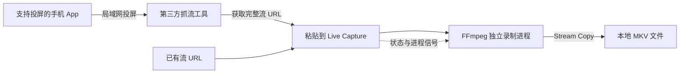

<div align="center">

# Live Capture

**把直播留在本地，把录制交给一个看得见的界面。**

面向 macOS 的 FFmpeg 直播录制管理器。粘贴流地址，创建任务，查看进度，保存原始音视频。

[](#requirements)
[](#choose)
[](#how-it-works)
[](GUI/README.md)
[](https://github.com/Nothings2Seeyeyeye/live-capture-recorder/stargazers)

**简体中文** · [English](README.en.md)

[快速开始](#quick-start) · [操作指南](#usage) · [获取直播地址](#capture-url) · [常见问题](docs/troubleshooting.md) · [参与贡献](CONTRIBUTING.md)

</div>

> **灵感来源**：Live Capture 参考了 [gtoxlili/wechat-finder-dlna](https://github.com/gtoxlili/wechat-finder-dlna) 的直播取流思路。感谢作者与贡献者公开分享实现，让我们有机会继续完善直播录制的使用体验。[查看完整致谢](#credits)。

> **第一次使用？** 有完整的 `m3u8` 流地址，直接按「快速开始」操作；只有视频号直播页面，先按「获取直播地址」操作，再回来创建录制任务。

<a id="why"></a>
## 为什么使用 Live Capture

一条 FFmpeg 命令可以开始录制；当你同时录几场活动、需要暂停或确认文件是否还在增长时，一个任务界面更便于管理。

- **原始画质**：默认使用 `-c copy`，直接保存音视频流，不重新编码。
- **多任务管理**：原生 App 将每场录制显示为独立卡片，包含 PID、文件路径、大小、媒体时长和处理速度。
- **进程控制**：提供 Pause、Resume、Stop 和 Kill，结束录制时可以让 FFmpeg 完成文件收尾。
- **保持唤醒**：可通过 macOS 自带的 `caffeinate` 降低录制期间因系统休眠而中断的机会。
- **接管已有任务**：原生 App 可以按 PID 附加到已经运行的 FFmpeg 进程。
- **便于修改**：Python / Tkinter 单任务版只有标准库依赖，录制逻辑集中在一个源码文件中。

适合保存课程直播、线上活动和同时进行的多个直播会场。Live Capture 负责管理录制；投屏发现和流地址捕获由独立的第三方工具完成。

<a id="contents"></a>
## 文档导航

| 想完成什么 | 从这里开始 |
| --- | --- |
| 安装并录下第一段视频 | [快速开始](#quick-start) |
| 决定使用原生版还是 Python 版 | [版本选择](#choose) |
| 从视频号投屏中获取流地址 | [获取直播地址](#capture-url) |
| 了解输入字段、按钮和任务状态 | [操作指南](#usage) |
| 录制多场直播、附加已有进程、转换 MP4 | [进阶用法](#advanced) |
| 找不到 FFmpeg、无法打开 App、没有声音 | [故障排查手册](docs/troubleshooting.md) |
| 运行和修改 Python 源码 | [Python GUI 文档](GUI/README.md) |
| 理解原生构建的限制 | [原生 App 文档](GUI/README-native.md) |
| 了解参考项目与作者贡献 | [灵感来源与致谢](#credits) |

<a id="choose"></a>
## 版本选择

| 能力 | 原生 macOS App | Python / Tkinter GUI |
| --- | --- | --- |
| 入口 | `GUI/Live Capture.app` | `GUI/app.py` |
| 并行录制 | 多任务 | 单任务 |
| 大小、时长、速度与日志 | 支持 | 支持 |
| Pause / Resume / Stop / Kill | 支持 | 支持 |
| 录制时保持唤醒 | 支持 | 支持 |
| Attach by PID | 支持 | 不支持 |
| 保存任务，重开时尝试接管存活进程 | 支持；以进程仍存活为前提 | 不支持 |
| 本仓库的交付形式 | 预编译 arm64 App | Python 源码 |
| 运行条件 | Apple Silicon、macOS 13+、FFmpeg | macOS、Python 3.11+、Tk、FFmpeg |

**推荐路径：** Apple Silicon 用户先使用原生 App；Intel Mac 用户和需要修改录制逻辑的开发者可以使用 Python 版。Python 版使用 macOS 进程信号与 `caffeinate`，当前未提供 Windows 支持。

当前仓库没有原生版的 Swift 源码或构建脚本，因此不能在本仓库内重新编译原生 App。原生 App 未经 Apple 公证，首次打开可能需要按系统提示处理；详见[故障排查](docs/troubleshooting.md#macos-open)。

<a id="requirements"></a>
## 环境要求

| 组件 | 何时需要 | 如何确认 |
| --- | --- | --- |
| macOS 13+ / Apple Silicon | 运行仓库中的原生 App | `sw_vers -productVersion`；`uname -m` 通常应为 `arm64` |
| FFmpeg | 所有录制方式 | `ffmpeg -version` |
| FFprobe | 检查录制文件 | `ffprobe -version`；通常随 FFmpeg 安装 |
| Python 3.11+ 与 Tk | 运行 Python GUI | `python3 --version`；`python3 -m tkinter` |
| Python 3.10+ | 第三方投屏抓流工具 | 推荐用 `uv tool install` 单独安装 |
| 同一局域网 | 手机投屏获取地址 | 避免相互隔离的访客网络 |

原生 App 自身不需要 Python。安装 FFmpeg 可以使用 [Homebrew](https://brew.sh/)；Homebrew 的系统支持范围与 App 的最低系统版本不同，旧版 macOS 请先查看其[安装要求](https://docs.brew.sh/Installation)。

<a id="quick-start"></a>
## 快速开始

以下命令在 macOS「终端」中执行。每组命令完成后，再继续下一步。

### 1. 安装 FFmpeg

已有 Homebrew：

```bash
brew install ffmpeg
ffmpeg -version
ffprobe -version
```

还没有 Homebrew：先按 [Homebrew 官方首页](https://brew.sh/)安装，并完成安装器给出的 PATH 设置，再执行上面的命令。看到 FFmpeg 与 FFprobe 的版本信息，就可以继续。

### 2. 下载项目并打开 App

```bash
git clone https://github.com/Nothings2Seeyeyeye/live-capture-recorder.git
cd live-capture-recorder
open "GUI/Live Capture.app"
```

不熟悉 Git，也可以在仓库页面点击 **Code → Download ZIP**，解压后在 Finder 中打开 `GUI/Live Capture.app`。双击 `app.py` 不会启动原生 App。

### 3. 设置第一条录制任务

1. 在「直播流 URL」中粘贴完整地址，包含 `?` 后面的所有参数。直播网页链接不能代替流地址。
2. 点击「选择…」，选一个你有写入权限的个人录制目录。原生版默认目录位于系统共享目录，正式录制前请改为自己的目录。
3. 「文件名前缀」填 `demo`。
4. 「最长录制时长」填 `00:00:30`，先做一次 30 秒试录。
5. 保持「录制时保持 Mac 唤醒」勾选，点击 **Add Recording**。

输出按「前缀 + 日期时间」命名，例如 `demo_20261011_103000.mkv`。日期时间来自本机时钟，不需要自己填写扩展名。

### 4. 确认录制成功

等待流初始化后，检查卡片中的文件大小和媒体时长是否持续增长。试录结束后，去保存目录打开 `.mkv` 文件，确认画面和声音都正常；可使用支持 MKV 的播放器，例如 [VLC](https://www.videolan.org/vlc/)。

正式录制时，将最长时长留空，或填写 `01:00:00` 等所需时长。留空表示不添加时长上限，任务会持续到手动停止、流结束或发生错误。

> **试录验收：** 文件已生成、有画面、有声音、时长合理。全部确认后，再开始长时间录制。

<a id="capture-url"></a>
## 获取直播地址

已有可用的 HLS / `m3u8` 地址，可以跳过这一节。需要通过视频号投屏获取地址时，可以使用独立项目 [wechat-finder-dlna](https://github.com/gtoxlili/wechat-finder-dlna)。它在局域网中宣告投屏接收设备，接收发送端提供的流 URL；Live Capture 使用这个 URL 录制。

### 1. 安装并启动抓流工具

推荐 [uv 的隔离工具安装方式](https://docs.astral.sh/uv/guides/tools/)，避免与 GUI 的 Python 环境混在一起：

```bash
brew install uv
uv tool install wechat-finder-dlna
uv tool run wechat-finder-dlna --name "Live Capture"
```

最后一条命令会保持运行，等待手机投屏。这里使用 `uv tool run`，即使工具可执行文件目录尚未加入 PATH，也可以调用。

<details>
<summary>已有 Python，希望使用 pip 和虚拟环境</summary>

```bash
python3 -m venv .venv-cast
.venv-cast/bin/python -m pip install wechat-finder-dlna
.venv-cast/bin/wechat-finder-dlna --name "Live Capture"
```

这个虚拟环境仅用于抓流，不用于解决 Tk 安装问题。不要使用 `sudo pip install`。

</details>

### 2. 在手机上投屏

1. 手机和 Mac 接入同一局域网，保持抓流终端运行。
2. 打开支持投屏的视频号直播，点击投屏入口。
3. 在设备列表中选择 **Live Capture**。
4. 回到终端，找到完整流 URL，通常包含 `.m3u8` 和签名参数。
5. 复制 URL 到 Live Capture，按快速开始的步骤录制。

投屏入口、设备可见性和协议取决于发送端 App。无法发现设备时，按[局域网排查步骤](docs/troubleshooting.md#cast-device)检查；地址过期后需要重新获取。

### 3. 只启用所需协议

第三方工具支持 DLNA、AirPlay 和 Google Cast。针对视频号，可以先尝试 DLNA：

```bash
uv tool run wechat-finder-dlna --protocol dlna --name "Live Capture"
```

这是第三方工具的能力，Live Capture 本身不提供投屏接收。回放、点播、DRM 和需要额外登录信息的流不属于本项目承诺支持的范围。

<a id="usage"></a>
## 操作指南

### 输入字段

| 字段 | 推荐填写 | 说明 |
| --- | --- | --- |
| 直播流 URL | 完整 `https://…/…m3u8?…` | 保留签名参数；界面无需给 URL 加引号 |
| 保存目录 | 使用「选择…」选择目录 | 推荐独立录制目录，确认剩余空间 |
| 文件名前缀 | `main-stage`、`class-01` | 不需要 `.mkv`；避免 `/` 等路径分隔符 |
| 最长录制时长 | `00:30:00` 或留空 | 使用 `HH:MM:SS`；限制输出媒体时长，不是预约停止的墙上时钟时间 |
| 保持 Mac 唤醒 | 长时间录制时勾选 | 不保证合盖、断电、断网或重启后继续录制 |

### 按钮行为

| 按钮 | 做什么 | 使用时机 |
| --- | --- | --- |
| **Add Recording** / **Start** | 创建 FFmpeg 进程 | 原生版可重复添加；Python 版一次一条 |
| **Refresh** | 手动更新任务信息 | 原生版中检查文件和进程状态 |
| **Pause** | `SIGSTOP`，暂停进程 | 不保证保存暂停期间的直播内容 |
| **Resume** | `SIGCONT`，恢复进程 | 长时间暂停后可能因源流或连接失效而无法继续 |
| **Stop** | `SIGTERM`，请求正常结束 | 日常结束录制；暂停状态先 Resume，再 Stop |
| **Kill** | `SIGKILL`，强制结束 | 进程无法正常退出时使用，文件可能不完整 |
| **Attach by PID** | 附加到现有 FFmpeg | 原生版中管理自己在终端启动的录制 |
| **清理已结束任务** | 整理已结束的任务卡片 | 先确认不再需要卡片中的信息 |

### 怎么看任务卡片

| 指标 | 含义 | 如何判断 |
| --- | --- | --- |
| 状态 | 当前任务阶段 | 运行中仍需检查文件是否增长 |
| PID | 对应进程编号 | 识别正在管理的录制 |
| 路径 / 大小 | 输出位置与已写入数据 | 大小长期不变时查看日志和网络 |
| 时长 | 已输出媒体的时间 | 与现实经过时间可能不同，尤其是读取源流缓存时 |
| speed | FFmpeg 媒体处理速度 | `1x` 约为实时；初始大于 `1x` 可能只是读取缓存 |
| 日志 / 上次刷新 | 处理消息与信息更新时间 | 定位签名失效、网络或容器问题 |

`Finished` 通常表示 FFmpeg 正常退出；`Exited` / `Failed` 需要检查日志；`Killed` 表示强制结束。Python 版收到 Stop 后也可能显示 `Exited`，不要仅凭标签判断文件损坏，应实际检查输出。

<a id="advanced"></a>
## 进阶用法

### 同时录制多场直播

原生 App 中依次填写流地址，用 `main-stage`、`workshop-a` 等不同前缀，分别点击 **Add Recording**。各卡片独立管理。并行任务共同使用网络带宽和磁盘写入资源。

### 附加终端中的 FFmpeg

在另一个终端启动后台任务，将占位 URL 替换为真实地址：

```bash
STREAM_URL='https://example.com/live/index.m3u8?replace=with-real-url'
mkdir -p "$HOME/Movies/LiveCapture"
OUTPUT="$HOME/Movies/LiveCapture/manual_$(date +%Y%m%d_%H%M%S).mkv"
ffmpeg -nostdin -hide_banner -i "$STREAM_URL" -c copy "$OUTPUT" \
  > "${OUTPUT%.mkv}.log" 2>&1 &
RECORDING_PID=$!
echo "$RECORDING_PID"
```

复制打印的 PID，填入原生 App 的附加输入框，点击 **Attach by PID**。卡片应显示 `Attached by PID`。附加任务的日志、速度与时长可见程度取决于已有进程的输出和文件信息，不保证与 App 内创建的任务完全一致。

只附加你能确认身份的录制进程。`$!` 必须紧接启动命令读取；不要填写抓流工具或终端本身的 PID。

### 将 MKV 转成 MP4

停止录制后，如果音视频编码适合 MP4，可以只换容器：

```bash
ffmpeg -n -i "recording.mkv" -c copy -movflags +faststart "recording.mp4"
```

替换成实际路径。`-n` 防止覆盖已有文件。编码不兼容时，查看[音视频与格式排查](docs/troubleshooting.md#media-output)。

### 检查文件与规划磁盘

```bash
ffprobe -v error -show_entries format=duration,size \
  -show_entries stream=codec_type,codec_name \
  -of json "recording.mkv"
```

粗略估算：**每小时 GB ≈ 总码率 Mbps × 0.45**，使用十进制单位，未计容器开销。例如 4 Mbps 约 1.8 GB / 小时。多任务用量相加，并预留空间；实际大小取决于源流码率。

<a id="how-it-works"></a>
## 工作原理



核心录制命令如下；设置时长时，在输出路径前加入 `-t HH:MM:SS`：

```bash
ffmpeg -nostdin -hide_banner -progress pipe:1 -nostats \
  -i "$STREAM_URL" -c copy "$OUTPUT"
```

Python 版勾选保持唤醒时，以 `caffeinate -dimsu` 包裹命令。原生版也使用 `caffeinate` 管理唤醒。GUI 管理进度和进程，音视频处理由本机 FFmpeg 完成。[FFmpeg 的 Stream Copy 文档](https://ffmpeg.org/ffmpeg.html#Streamcopy)解释了不重新编码的方式与容器限制。

默认 MKV 容器适合长时间写入和录后重新封装，但不能保证强制中断后完全可用。原生版还会尝试录后时间轴处理；日志提示修复失败时，按[时间轴排查](docs/troubleshooting.md#timeline)处理。

<a id="limitations"></a>
## 当前边界

- 不自动寻找 URL、不自动刷新签名、不保证断流重连，也不补录错过的内容。
- Pause 暂停的是进程，不是直播源，不能无限期缓冲暂停期间的内容。
- 原生 App 重开时尝试接管仍存活的进程；系统重启后不会自动重建录制。
- Python 版没有多任务列表、PID 附加和任务持久化。建议先 Stop，等待退出后再关窗口。
- 原生 App 为 arm64；未提供其他平台的原生构建、Swift 源码或本地构建入口。
- GUI 没有自定义 Cookie、HTTP Header 或 DRM 解密配置。

<a id="faq"></a>
## 常见问题

| 问题 | 先做什么 |
| --- | --- |
| 投屏列表找不到设备 | 检查局域网、访客隔离和组播；[详细步骤](docs/troubleshooting.md#cast-device) |
| App 打不开 | 核对芯片、系统与系统提示；[详细步骤](docs/troubleshooting.md#macos-open) |
| 找不到 `ffmpeg` | 核对安装路径；原生构建使用 `/opt/homebrew/bin/ffmpeg`；[详细步骤](docs/troubleshooting.md#ffmpeg-path) |
| Python 缺少 `_tkinter` | 安装与解释器版本匹配的 Tk；[详细步骤](docs/troubleshooting.md#python-tk) |
| 文件不增长、URL 过期 | 查日志，重新获取完整 URL；[详细步骤](docs/troubleshooting.md#stalled) |
| MKV 无法播放、没有声音 | 用 FFprobe 检查流与播放器兼容性；[详细步骤](docs/troubleshooting.md#media-output) |
| 暂停后 Stop 没反应 | 先 Resume，再 Stop；[详细步骤](docs/troubleshooting.md#paused-stop) |

<a id="structure"></a>
## 项目结构

```text
live-capture-recorder/
├── GUI/
│   ├── Live Capture.app/     # arm64 预编译原生 App
│   ├── app.py                # Tkinter 单任务 GUI 源码
│   ├── launch.command        # 使用 PATH 中的 python3
│   ├── README.md             # Python 环境与运行说明
│   └── README-native.md      # 原生使用与构建状态
├── docs/
│   └── troubleshooting.md    # 按现象组织的故障排查
├── .github/                  # Issue / Pull Request 模板
├── CONTRIBUTING.md           # 贡献与验证要求
├── README.md                 # 中文文档
├── README.en.md              # English documentation
└── pyproject.toml            # Python 项目元信息
```

录制文件、日志、虚拟环境与本地第三方克隆不纳入仓库。`pyproject.toml` 不是安装原生 App 的入口；运行 Python GUI 无需 `pip install .`。

<a id="contribute"></a>
## 参与贡献

欢迎提交使用问题、文档修正和 Python GUI 改进。阅读[贡献指南](CONTRIBUTING.md)，反馈时附上运行方式、版本、复现步骤和脱敏日志。

[报告问题](https://github.com/Nothings2Seeyeyeye/live-capture-recorder/issues/new/choose) · [提出改进](https://github.com/Nothings2Seeyeyeye/live-capture-recorder/issues/new/choose)

当前仓库尚未添加项目级 LICENSE 文件。独立安装的第三方工具适用各自许可证。

<a id="credits"></a>
## 灵感来源与致谢

Live Capture 的创作参考了 [wechat-finder-dlna](https://github.com/gtoxlili/wechat-finder-dlna)。它通过 DLNA、AirPlay 和 Google Cast 等标准投屏协议捕获直播流地址，为本项目探索视频号直播录制提供了思路和实践参考。特别感谢 [@gtoxlili](https://github.com/gtoxlili) 与项目贡献者分享这项工作。

两个项目可以配合使用：**wechat-finder-dlna 负责获取直播流地址，Live Capture 负责将地址变成可管理的录制任务**，提供多任务界面、进度查看、暂停与停止、保持唤醒和已有进程接管。两者独立维护，抓流工具按上游说明单独安装。

如果这套流程对你有帮助，也欢迎前往 [wechat-finder-dlna 原项目](https://github.com/gtoxlili/wechat-finder-dlna) 点一个 Star，支持作者与贡献者。

同时感谢以下项目与资源：

- [FFmpeg](https://ffmpeg.org/)：音视频输入、流复制和容器处理。
- [Tkinter](https://docs.python.org/3/library/tkinter.html)：Python GUI 的标准库界面模块。

如果 Live Capture 帮你保存了一场重要直播，欢迎通过 Star 支持项目，也欢迎用 Issue 分享可复现的改进建议。
